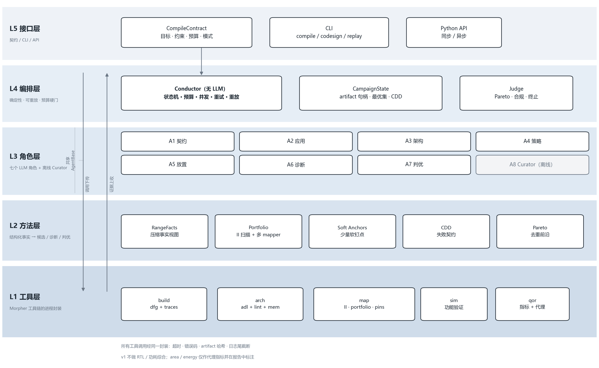
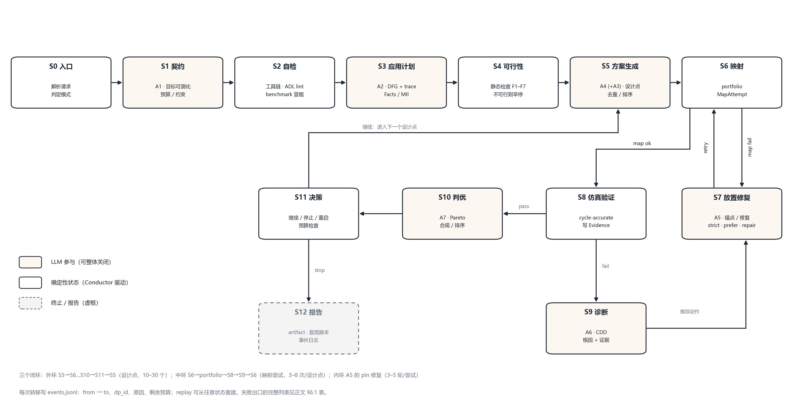

# CGRA Agent Compiler 工作流架构

**版本**：v0.1（设计稿）  
**日期**：2026-10-26  
**范围**：以 Morpher 为后端的 agent 化 CGRA 编译流程；不含 RTL 生成与物理实现。  
**配套文档**：[接口与数据模型](INTERFACES.md)、[关键决策记录](DECISIONS.md)

---

## 0. 一页纸

**输入**：一个带 kernel 标注的 C 程序、一套 CGRA 架构（固定，或一个受限的架构空间）、一个可被工具测量的目标（cycles / II / 编译时间）、一份预算（墙钟、工具调用数、token）。

**输出**：一个通过 cycle-accurate 仿真验证的映射（bitstream + trace 证据）、一份 Pareto 候选表、一份可复现的实验报告。

**系统形态**：五层架构 + 七个 LLM agent + 一个确定性调度器 + 三个嵌套闭环 + 一个共享诊断中间表示（CDD）。

**核心主张**：

> LLM 不生成编译器，也不替代路由。LLM 在编译器内部提出**可被工具立即证伪的结构假设**：把关键子图锚定到合适的 PE/相位，把失败日志翻译成根因，把根因翻译成合法的下一步动作。路由交给 PathFinder，正确性交给仿真器。

**一条硬规则**：

> 任何候选在进入 Pareto 前沿之前，必须 `mismatches == 0`。映射成功（mapper 返回 ok）只说明没有资源超订，不等于功能正确。

---

## 1. 背景与切入点

### 1.1 三篇参考工作真正给出的东西

| 机制 | 来源 | 我们怎么用 | 我们改什么 |
|---|---|---|---|
| 按失败模式拆专职 agent，而不是一个通用 repair prompt | MACO | A2–A6 各自绑定一类失败码与一类工具 | 把“设计点级”修复下沉到“映射/放置级” |
| 两级评审：LLM 粗筛，工具精评；置信度门控昂贵调用 | MACO / MALTA | 廉价 oracle 阶梯 + 预算账本 | 正确性不容许被门控跳过，只门控 QoR 评估 |
| 报告驱动而非标量驱动；分层诊断；BSD 作为共享 IR 与检索键 | Beacon | CDD（编译诊断描述符） | 从“层/算子”细化到“DFG 节点/PE/周期/端口” |
| LLM 只给方向，adapter 负责合法化、物化、查重 | Beacon | `DesignMove` + Materializer | 动作空间是编译器的 legal move，不是硬件参数邻域 |
| ε-greedy 用在“检索哪段历史”上，而非温度 | MACO | 记忆检索配额 | 同时用配置指纹做负迁移抑制 |
| ReAct 逐步取证 + step budget + schema 校验 | Beacon | 每个 agent 的单轮工具预算与结构化输出 | 工具白名单更窄，禁止 shell |

### 1.2 共同空白

三篇工作（MACO/MALTA、Beacon）都在**设计点层**工作：agent 选参数，工具链是黑盒评估器。由此产生三个后果：

1. **映射失败只是一个数字**。工具说 fail，agent 不知道是 placement 非法、路由拥塞、bank 绑定错误，还是 II 给低了。修复只能靠重采样。
2. **编译器内部的自由度没有被 agent 使用**。调度、放置、路由、II 都是编译器自己决定的；LLM 只能改“外围参数”（unroll、tile size、bank 数）。
3. **正确性被默认成立**。MACO/MALTA 用映射成功与综合结果作为信号；Beacon 用仿真，但仍在设计点层。没有工作把“编译成功”与“功能正确”显式分开，并针对二者的差异做诊断。

Morpher 恰好提供了一个罕见的接口：`mapping_method=3` 允许外部给出逐节点的 `(x, y, t)` pin，mapper 在 pin 的约束下完成路由；mapper 还会输出结构化的 report（`stage`、`pins_applied`、`pins_rejected`），仿真器能给出逐周期的断言位置。**这把“放置”变成了 agent 可以实际动手、且能被立即验证的编译动作。**

### 1.3 三个可检验假设

- **H1（放置先验）**：在 recurrence、长依赖链、bank 约束强的 DFG 上，LLM 的全局结构先验能给出比“从零搜索”更好的锚点；但把完整放置交给 LLM 会损害可路由性，因此应使用**少量软锚点**而非全量硬 pin。
- **H2（诊断效率）**：结构化 CDD 比原始日志或标量奖励更能把修复路由到正确层级，从而降低“首次通过验证”所需的工具调用数。
- **H3（等预算不劣）**：在相同工具预算下，三层闭环 + 确定性 portfolio 的通过率与 II 不劣于最强启发式组合，并在困难 kernel 上有可复现的增益。

这三条直接对应第 13 节的 RQ1–RQ3。

### 1.4 边界（明确不做）

- 不做 RTL 生成、综合、布局布线；只预留 `qor` 接口。
- 不做通用的 C 自动并行化；应用变换限定在已定义的 legal moves。
- 不声称跨架构泛化，除非在第二套 ADL 上完成同协议评估。
- 不让 LLM 直接生成 ADL 连接或 bitstream；这两处的幻觉成本最高、验证最贵。
- 不把 LLM 当数值优化器；连续参数搜索交给 BO/网格，LLM 负责离散结构与诊断。

---

## 2. 设计原则

**P1. Oracle-first。** LLM 输出的是“假设”，不是“事实”。任何进入报告的数字必须来自工具，且带 artifact 引用。LLM 的自我评估只能用于排序，不能用于验收。

**P2. 按失败模式分层。** 一个 agent 对应一类失败签名、一类工具、一类修复算子。禁止“通用修复”agent。若两个 agent 的工具和输出 schema 高度重合，就合并。

**P3. 硬边界。** LLM 只给方向；确定性 adapter 负责合法化、物化、去重、预算记账。动作空间是单步邻域，任何一步都必须能落到一个可编译的配置上。

**P4. 成本感知。** 工具调用分级：静态检查 < quick map < full map < 仿真 < 综合。每次调用前申报预估成本，预算不足则拒绝执行或降级。预算是一等公民，不是事后统计。

**P5. 经验可积累，但不锁死。** 检索同时取“高性能案例”和“高方差案例”，用衰减的 ε 控制比例；定期做无记忆冷启动，度量记忆的真实增益。

**P6. 可复现。** 每个 run 记录：git commit、二进制 hash、ADL hash、config、seed、完整 prompt、工具 stdout/stderr、耗时。事件日志可重放到任意状态。

---

## 3. 总体架构



| 层 | 职责 | 关键对象 | 明确不做 |
|---|---|---|---|
| L5 接口层 | 契约解析、CLI / Python API、报告、人工确认 | `CompileContract`、`Report` | 不承载业务逻辑 |
| L4 编排层 | 状态机、预算、并发、重试、检查点、硬门 | `CampaignState`、`BudgetLedger` | 不做领域决策 |
| L3 角色层 | 七个 LLM 角色 + 离线 Curator | 见 §5 | 不直接执行 shell |
| L2 方法层 | 事实构建、确定性 portfolio、软锚点、CDD、Pareto | `RangeFacts`、`CDD`、`Verdict` | 不直接调用二进制 |
| L1 工具层 | Morpher 进程封装：build / arch / map / sim / qor | 进程、退出码、artifact hash | 不被 agent 直接调用 |

### 3.1 黑板式协作，不是对话式协作

所有 agent 共享一个**类型化黑板** `CampaignState`，只读写不可变 artifact 与指针。agent 之间不发自然语言消息，Conductor 只把当前决策需要的最小切片注入 prompt。

这样做的理由：

- 对话式协作会让上下文随轮次线性膨胀，且难以复现“为什么当时那么说”。
- 编译器已经提供了结构化状态（DFG、facts、report、sim trace），没有理由把它压成聊天记录再让模型解析。
- 黑板让每个 artifact 有唯一 id 与 hash，便于缓存、去重、回滚、审计。

### 3.2 确定性 Conductor + 概率性 Agent

Conductor 是普通 Python，不是 LLM。它拥有：状态转移、预算扣减、并发调度、重试上限、检查点、硬门（correctness gate）。LLM 只在“下一步做什么”存在多义时被调用，且输出必须是一个 `DesignMove` 或一个 `Verdict`，不能直接改变状态机。

这条边界是可复现性的基础：同一事件日志 + 同一模型版本 + 同一 seed，应能重放出同一决策序列。

---

## 4. 数据模型

完整 schema 见 [INTERFACES.md](INTERFACES.md)。这里只给形状与不变量。

### 4.1 CompileContract

```json
{
  "contract_id": "c-20261026-gemm-01",
  "mode": "compile",
  "app": {"source": "benchmarks/gemm.c", "kernel": "gemm", "entry": "kernel_gemm"},
  "arch": {
    "kind": "fixed",
    "adl": "json_arch/hycube_original.json",
    "xdim": 4, "ydim": 4, "banks": 2, "banksize": 2048
  },
  "objective": {
    "primary": "cycles", "direction": "min",
    "constraints": {"ii_max": 8, "verified": true}
  },
  "correctness": {"require_sim_pass": true, "traces": 4, "tolerance": 0},
  "budget": {"wall_s": 1800, "map_calls": 40, "sim_calls": 20, "llm_calls": 60, "tokens": 200000},
  "search": {
    "allowed_transforms": ["unroll", "if_convert"],
    "allowed_mappers": [0, 1, 2, 3],
    "allowed_pin_modes": [2, 1, 3],
    "ii_max": 8
  }
}
```

不变量：

- `objective.primary` 必须是工具可直接测量的量。`cycles`、`ii`、`wall_s` 可以；`power`、`area` 在没有模型时不可以，Contract Agent 必须拒绝或要求用户提供模型。
- `correctness.require_sim_pass` 在本项目中恒为 `true`；字段存在是为了未来接入形式化检查。
- `budget` 的所有字段都非负；`0` 表示“不允许该类调用”。

### 4.2 DesignPoint

一个设计点是“应用形态 × 架构 × 映射策略”的三元组，是外层搜索的基本单位。

```json
{
  "dp_id": "dp-7f3a",
  "app": {"dfg_type": "PartPred", "transforms": {"unroll": 2, "if_convert": true}},
  "arch": {"adl": "json_arch/hycube_original.json", "patch": {"banks": 4}},
  "map": {"portfolio": ["pf@mii", "sa@mii", "llm-prefer@mii"], "timeout_s": 600}
}
```

`dp_id = sha256(canonical_json(app, arch, map))[:12]`。指纹用于缓存、去重、记忆检索。

### 4.3 Evidence / Candidate / Verdict

```json
{
  "candidate_id": "cand-7f3a-02",
  "dp_id": "dp-7f3a",
  "artifacts": {"dfg": "sha256:...", "pins": "sha256:...", "bitstream": "sha256:...", "sim_log": "sha256:..."},
  "evidence": {
    "build": {"nodes": 26, "mii": 3, "res_mii": 3, "ops": {"MAC": 8, "LOAD": 9}},
    "map": {"ok": true, "ii": 3, "lat": 3, "seconds": 42.1, "pins_applied": 18, "pins_rejected": 0},
    "sim": {"ran": true, "matches": 4096, "mismatches": 0, "cycles": 1180},
    "cost": {"wall_s": 61.3, "llm_calls": 2, "tokens": 3100}
  },
  "verified": true
}
```

`verified` 只能由 Conductor 在检查 `sim.mismatches == 0` 后写入；agent 不能写。

### 4.4 CDD：编译诊断描述符

CDD 是整个系统的共享中间表示，作用有三：路由修复、作为记忆检索键、作为报告的最小解释单元。

```json
{
  "cdd_id": "cdd-9c1",
  "scope": {"level": "region", "nodes": [12, 13, 14], "pe": [[2, 1]], "cycles": [40, 80]},
  "symptom": {"stage": "route", "code": "ROUTE_CONGESTION", "message": "edge 12->13 unroutable at II=3"},
  "primary_impact": "latency",
  "root_cause": "routing_congestion",
  "evidence": [
    {"kind": "map_report", "ref": "sha256:...", "field": "fail_edges[0]"},
    {"kind": "facts", "ref": "sha256:...", "field": "node[13].parents"}
  ],
  "recommended_actions": [
    {"op": "repin_region", "args": {"nodes": [12, 13], "mode": "prefer"}, "expected": "free port OUT1 at (2,1)"},
    {"op": "ii_plus", "args": {"delta": 1}, "expected": "extra phase slot"}
  ],
  "confidence": 0.72,
  "analysis_base": "best"
}
```

`root_cause` 的取值是封闭集合：`recurrence`、`routing_congestion`、`bank_conflict`、`phase_violation`、`pe_imbalance`、`dfg_too_large`、`unsupported_op`、`memory_layout`、`ii_bound`、`schedule_conflict`、`unknown`。封闭集合让 CDD 可统计、可检索、可做混淆矩阵。

### 4.5 CampaignState

```python
class CampaignState(TypedDict):
    contract: CompileContract
    app: AppArtifact
    arch: ArchArtifact
    points: dict[str, DesignPoint]
    attempts: dict[str, list[MapAttempt]]
    evidence: dict[str, Evidence]
    cdd: dict[str, CDD]
    candidates: dict[str, Candidate]
    frontier: list[str]              # Pareto 前沿的 candidate_id
    budget: BudgetState
    events: list[Event]
```

检查点在每次状态转移后落盘：`runs/<campaign>/state.json` + `events.jsonl`。

---

## 5. Agent 角色

### 5.1 角色总表

| ID | 角色 | 触发 | 主要工具 | 输出 | 对应失败码 |
|---|---|---|---|---|---|
| A0 | Conductor（确定性） | 每步 | 全部（经工具层） | 状态转移、预算、裁决执行 | F9/F10 |
| A1 | Contract Agent | 会话开始 | schema、arch_lint | `CompileContract` | — |
| A2 | App/DFG Agent | DFG 构建失败或需要应用变换 | `dfg_build`、`trace_build`、`dfg_stats` | `AppPlan` + DFG + Facts | F1/F2 |
| A3 | Architecture Agent | 架构非法或 codesign 模式 | `arch_lint`、`arch_patch`、`mem_layout` | `ArchPlan` | F3 |
| A4 | Mapping Strategist | 每个设计点 | `estimate_mii`、`map`、`facts` | `MapPlan`（按成本排序） | F5/F8 |
| A5 | Placement Agent | 需要 LLM 锚点或路由修复 | `validate`、`map`、`sim` | `pins.json` + 解释 | F4/F5 |
| A6 | Diagnostician | 仿真失败或 QoR 差 | `sim`、`report`、`trace_diff` | `CDD` | F6/F7/F8 |
| A7 | Judge | 每轮结束 | 只读证据、`qor` | `Verdict` | — |
| A8 | Curator（离线） | campaign 结束 / 每 N 个 case | `memory_write`、`summarize` | `CaseRecord` + 知识库更新 | — |

七个 LLM 角色不是拍脑袋拆的。拆分标准只有一条：**是否存在一类独立的失败签名，且修复它需要一套不同的工具与不同的输出 schema**。按此标准，A1（契约）、A2（构建）、A3（架构）、A4（策略）、A5（放置）、A6（诊断）、A7（裁决）各自成立；A8 不在关键路径上，单独离线运行。

### 5.2 A1 Contract Agent

**使命**：把自然语言变成机器可执行、可验收的合同；拒绝不可测目标；补默认值；在歧义处提问而不是猜。

**输入**：用户请求、可用架构清单、工具能力清单、历史合同。

**输出**：`CompileContract` + `clarifications[]`（若为空则可直接执行）。

**硬约束**：

- 目标必须能映射到工具输出字段；不能映射就问用户，或给出 2–3 个可测替代。
- 预算必须显式；未给则用配置文件默认值并在报告中标注。
- 不允许把 `power` 写成目标而没有功耗模型；可以写成 `cycles` 的代理目标并注明。

**停止**：schema 校验通过 + 目标可测 + 预算非零。

**失败升级**：连续两次无法形成可测目标 → 返回“需要人工定义目标”，不进入编译循环。

### 5.3 A2 App/DFG Agent

**使命**：选择 kernel 与入口，决定 DFG 类型、循环变换与内存布局提示，生成 DFG 与测试向量，并保证 DFG 在目标架构上“原则上可映射”。

**输入**：contract、C 源码、架构 facts、相似 kernel 的历史案例。

**输出**：

```json
{
  "dfg_type": "PartPred",
  "transforms": {"unroll": 2, "if_convert": true, "restrict_ptrs": true},
  "mem_layout_hint": {"A": "bank0", "B": "bank1"},
  "rationale": "recurrence on acc; unroll 2 keeps DFG under 80 nodes",
  "expected": {"nodes": 58, "mii": 4}
}
```

**工具**：`dfg_build`（clang/opt/dfggen）、`trace_build`（插桩 + host 运行）、`dfg_stats`、`arch_lint`。

**修复算子**：

- unsupported op → if-convert、改写为支持的操作、换 DFG 类型；
- DFG 过大 → 降低 unroll、切分循环、按基本块拆分；
- 指针/别名导致地址分析失败 → 加 `restrict`、改为局部数组、显式拷贝；
- trace 缺失 → 生成最小测试向量；若无法生成，合同降级为“仅映射、不验证”，但必须在报告中标红。

**硬约束**：任何语义改写都必须通过 host 参考输出比对；不能只“看起来对”。

**停止**：DFG 生成成功 + `dfg_stats` 通过 + trace 可用（或合同允许无 trace）。

### 5.4 A3 Architecture Agent

**使命**：在受限的架构空间内提出变体；理解 Morpher ADL 能表达什么、不能表达什么。

**输出**：

```json
{
  "template": "hycube_4x4",
  "patch": {"banks": 4, "banksize": 2048, "edge_mem_pes": true},
  "adl_path": "runs/.../arch.json",
  "rationale": "LOAD pressure high; doubling banks halves bank conflicts",
  "expected": {"area_proxy": 1.18, "mii": 3}
}
```

**工具**：`arch_lint`、`arch_patch`、`mem_layout`、`area_proxy`。

**硬约束**：

- 只允许“模板 + 合法 patch”，不允许自由生成 `CONNECTIONS`。ADL 的连接图幻觉成本极高，且 `arch_lint` 也未必能覆盖语义错误。
- 任何 patch 必须落在 `configs/space/*.yaml` 声明的范围内；越界直接拒绝并返回合法邻域。
- 修改 bank 数后必须重跑 `update_mem_alloc.py`，否则 `DATA_LAYOUT` 与 memory PE 不一致。

**停止**：lint 通过 + DFG 的 op 全覆盖 + bank 容量足够 + 与当前 DFG 的变量绑定一致。

### 5.5 A4 Mapping Strategist

**使命**：为一个设计点选择映射组合（mapper、II、timeout、是否上 LLM、pin 策略），按成本升序排成尝试队列。

**输出**：

```json
{
  "attempts": [
    {"method": 0, "ii": "mii", "timeout_s": 120, "pins": null},
    {"method": 2, "ii": "mii", "timeout_s": 300, "pins": null},
    {"method": 3, "ii": "mii", "timeout_s": 300, "pins": {"mode": 2, "scope": "critical"}}
  ],
  "stop_on": "first_verified",
  "rationale": "MII=3, ResMII=3; try cheap first, LLM only if II gap persists"
}
```

**硬约束**：

- 不猜 II。`ii` 只能取 `mii`、`mii+k`（k 由 contract 限制）或显式整数；`mii` 由 `estimate_mii` 给出。
- 方法 3 不扫 II，这是实现事实；因此 II 扫描必须由 Conductor 在方法 3 之外完成。
- 尝试队列长度 ≤ 5，总预估成本 ≤ 剩余预算。

**停止**：队列非空且成本可接受。

**说明**：这个角色可以很轻（规则 + 小模型）。它的价值不在“聪明”，而在**决定何时值得调用昂贵的 LLM 放置**。

### 5.6 A5 Placement Agent

**使命**：生成少量高质量锚点 `(node, x, y, t)`，用 LLM 的结构先验改善可路由性与 II；失败时按 CDD 做局部修复。

**输入**：`facts`（紧凑文本）、II、架构、锚点选择器的输出、历史相似 pins、CDD。

**输出**：

```json
{
  "analysis": "acc recurrence 0->3->0 needs t(3)=t(0)+1; pin the SCC, leave loads free",
  "pins": [{"node": 0, "x": 0, "y": 0, "t": 0}, {"node": 3, "x": 1, "y": 0, "t": 1}],
  "unpinned": [7, 8, 9],
  "mode": "prefer",
  "confidence": 0.66,
  "evidence_refs": ["facts:scc", "facts:node_bank"]
}
```

**三档 pin 策略**（对应 Morpher 的 `pins_mode`）：

| 策略 | pins_mode | 语义 | 何时用 |
|---|---|---|---|
| `prefer` | 2 | 尽量满足，不可满足则交回 mapper | **默认**；部分锚点 |
| `strict` | 1 | 必须满足，否则失败 | 小 DFG、高置信、需要可复现的精确布局 |
| `repair` | 3 | 丢弃不可满足的 pin，继续映射 | 前两轮失败后的兜底 |

**关键设计：软锚点，而非全量硬 pin。** 全量 pin 把路由自由度压到零，PathFinder 的强项被废掉；少量锚点（recurrence SCC、最长链的每 k 个节点、高扇出节点、memory 节点）既注入结构先验，又保留路由空间。锚点选择由确定性代码完成：

```python
def select_anchors(facts, k=8):
    # 1) 所有在非平凡 SCC 中的节点（recurrence）
    # 2) 最长路径上的等距采样
    # 3) fanout >= 3 的节点
    # 4) LOAD/STORE（bank 约束已经确定，pin 可减少搜索）
    # 去重后按“约束强度”排序，取前 k 个
```

**硬约束**：

- 必须通过 `validate` 的 R1–R7；错误 pin 在进入 mapper 前就被拒绝。
- 不允许改 op、改图、改 bank 绑定；这些属于 A2/A3。
- 每轮最多一次 map 调用；总轮数 ≤ 3（可由预算调整）。
- 失败时必须返回 `pins_rejected` 的解释，而不是重试同一组 pin。

**停止**：`map ok` 且 `sim pass`；或轮数/预算耗尽。

**反模式**：让 LLM 决定路由路径、让 LLM 输出完整 bitstream、让 LLM 在失败后“再试一次同样的东西”。

### 5.7 A6 Diagnostician

**使命**：把仿真失败或 QoR 不佳转成 CDD；定位到 PE/周期/节点；区分“编译/映射错”与“语义/测试向量错”。

**输入**：sim 日志、map report、DFG、pins、架构、历史 CDD。

**输出**：CDD + 证据链 + 推荐的合法动作（不直接执行）。

**诊断路径**：

1. `mismatches > 0` 且仿真正常结束 → 取首个失配地址，回溯写该地址的 STORE 节点与它的输入锥；检查相位差是否满足曼哈顿距离。
2. 仿真断言（同一周期两个操作数）→ 取断言的 `(x, y, cycle, op)`，找出该 PE 上 `[cycle-II, cycle]` 内映射的节点；检查 SELECT/CMERGE 的两个父节点相位是否相同。
3. 映射失败 `stage=route` → 取 `fail_edges` 的 hop 数与相位差；若 `phase_gap < hops`，根因是 `phase_violation`；若端口超订，根因是 `routing_congestion`。
4. 映射失败 `stage=placement` → 根因是 `phase_violation` 或 `bank_conflict`，直接回 A5。
5. 通过但 II 高于 MII → 根因是 `ii_bound` 或 `routing_congestion`；先试 mapper 组合，再试锚点。
6. 通过且 II=MII 但 cycles 高 → 根因是 `pe_imbalance` 或 `memory_layout`；需要仿真器的利用率/ bank 访问计数（见 §11.7）。

**硬约束**：CDD 的每条 evidence 必须指向一个 artifact 字段或一段日志行；不允许“我觉得”。无法定位时输出 `root_cause=unknown` 并升级人工，而不是编一个原因。

### 5.8 A7 Judge

**使命**：候选比较、接受/拒绝、Pareto 维护、回归检测、合同合规检查。

**输入**：已验证候选、合同、预算状态、历史 best。

**输出**：

```json
{
  "decision": "accept",
  "pareto_rank": 1,
  "reasons": ["verified", "ii=3=mii", "cycles best so far"],
  "next": "continue",
  "reject": [{"candidate_id": "cand-...", "reason": "unverified"}]
}
```

**规则（按优先级）**：

1. 未 verified 的候选不参与排序，只能作为“诊断素材”。
2. 硬约束（`ii_max`、`area_proxy_max`）先过滤。
3. 主目标比较；同分看次目标；再同分看成本（墙钟 + token）。
4. 多目标时维护 Pareto 前沿，不做标量化，除非合同显式给了权重。
5. 与历史 best 比较时，必须做配对：同 kernel、同架构、同 trace 数。

**硬约束**：不能使用 LLM 估计的 II/cycles 替代实测；不能把“映射成功”当作“功能正确”。

### 5.9 A8 Curator

**使命**：把一次 campaign 变成可复用经验；去重、归因、写知识库、维护索引。

**输出**：`CaseRecord`（成功与失败都存）、知识库条目候选、索引更新。

**写入策略**：

- 只写被工具证实的因果关系（“把 SCC 锚定后 II 从 4 降到 3，sim pass”），不写 LLM 的猜测。
- 每条记录带 provenance：contract、dp_id、candidate_id、artifact hash、模型版本。
- 负结果同样保留；它们是“哪条路不通”的证据，比正结果更稀缺。

**触发**：campaign 结束、每 20 个 case、或人工请求。离线运行，不阻塞编译。

### 5.10 A0 Conductor

确定性组件，职责：

- 状态机推进与转移条件判定；
- 预算扣减与拒绝（超预算的动作不执行）；
- 并发调度（map worker 池、sim worker 池）；
- 重试与退避（工具失败、LLM JSON 解析失败）；
- 硬门：`verified` 只能由它写；
- 检查点与事件日志；
- 失败码归一化（把工具的各种错误映射到 F1–F10）。

Conductor 不做领域判断；遇到多义分支时调用一个小型 policy 模型，输出必须是 `DesignMove` 或 `Verdict`。

---

## 6. 工作流

### 6.1 状态机

状态机在实现上就是 LangGraph 的 `StateGraph`：表中每个状态是一个节点，成功/失败出口是条件边，`S6 MAP` 的并行假设用 `Send` 扇出；`SqliteSaver` 负责检查点与回放（见 `docs/ENGINEERING_PLAN.md` §5）。



| 状态 | 负责 | 主要动作 | 成功出口 | 失败出口 |
|---|---|---|---|---|
| S0 INTAKE | Conductor | 解析请求、定位文件、判定模式 | S1 | S12（输入缺失） |
| S1 CONTRACT | A1 | 生成/校验合同 | S2 | S1（澄清） |
| S2 RECON | Conductor | 工具链自检、ADL lint、benchmark 冒烟 | S3 | S12（环境坏） |
| S3 APP_PLAN | A2 | 构建 DFG、生成 trace、算 facts | S4 | S3（改写重试） |
| S4 FEASIBILITY | Conductor | 静态可行性 F1–F7 | S5 | S3/S5/S12 |
| S5 PROPOSE | A4(+A3) | 生成设计点/移动，去重，排序 | S6 | S11（预算尽） |
| S6 MAP | Conductor | 执行 portfolio，收集 MapAttempt | S8（ok） | S7（可修）/S9 |
| S7 PLACE_REPAIR | A5 | 锚点生成/修复，strict/prefer/repair | S6（重试） | S9（耗尽） |
| S8 VERIFY | Conductor | 仿真，写 Evidence | S10（pass） | S9（fail） |
| S9 DIAGNOSE | A6 | 生成 CDD，推荐动作 | S5/S6/S7 | S12（放弃） |
| S10 JUDGE | A7 | 排序、Pareto、合规 | S11 | — |
| S11 DECIDE | Conductor | 继续/停止/重启 | S5 | S12 |
| S12 REPORT | Conductor+A8 | 报告、artifact、复现脚本 | END | — |

### 6.2 三个嵌套闭环

```
外环（设计环）   S5 → [S6 → S7* → S8 → S9]* → S10 → S11 → S5
                 预算：10–30 个设计点；决策粒度：应用变换 / 架构 / 映射策略

中环（尝试环）   S6 → portfolio → S8 → S9 → S6
                 预算：每个设计点 3–8 次映射；决策粒度：mapper / II / timeout

内环（修复环）   A5.propose → validate → map(prefer) → map(strict) → map(repair)
                 预算：每个尝试 3–5 轮；决策粒度：单节点/子图的 (x,y,t)
```

三个环的**退出条件不同**：

- 内环：`sim pass`，或 3 轮无改善，或 pin 预算耗尽。
- 中环：拿到一个 verified 候选，或 portfolio 耗尽，或该设计点被判定“在当前 II 上限内不可行”。
- 外环：合同满足、预算耗尽、Pareto 前沿连续 3 轮不变、或证明不可行。

### 6.3 预算与终止

预算是一个结构体，不是单一墙钟：

```json
{"wall_s": 1800, "map_calls": 40, "sim_calls": 20, "llm_calls": 60, "tokens": 200000}
```

成本核算（相对单位，可配置）：

```
cost = 1.0 * map_seconds
     + 2.0 * sim_seconds
     + 20.0 * llm_calls
     + 1.0 * (tokens / 1000)
```

Conductor 在每次动作前检查 `remaining >= estimated_cost`；不足则拒绝，并让 agent 选择更便宜的替代动作（例如 quick mapper 或跳过 LLM）。

**终止条件**（满足任一）：

- `target_met`：合同的主目标与全部硬约束满足；
- `budget_exhausted`；
- `pareto_stable`：连续 3 轮前沿不变，且没有新的 verified 候选；
- `infeasible`：`MII > ii_max`，或 `nodes > xdim*ydim*ii_max`，或存在无合法改写的 unsupported op；
- `human_abort`。

注意区分“证明不可行”与“预算内没找到”。前者可以写进报告，后者只能写“未找到”，不能声称不可行。

### 6.4 人工介入点

- 合同歧义（目标不可测、预算缺失、架构不存在）；
- 架构 patch 超出模板范围；
- 需要修改 Morpher C++ 或新增 ADL 原语；
- 最终目标未达成，但已找到 Pareto 候选，需要人决定是否接受；
- 安全/合规问题（例如源码包含不允许外发的数据）。

默认 `--auto` 模式下，前两类直接失败并报告，不阻塞批处理。

### 6.5 一个走完的例子（数值为说明用）

kernel `gemm`，4×4 HyCUBE，2 banks，目标 cycles 最小，预算 30 分钟。

1. **合同**：`cycles` 可测；`require_sim_pass=true`；`ii_max=8`；预算 30 min / 40 map / 20 sim / 60 LLM calls。
2. **构建**：DFG 26 节点，PartPred，MII=3，ResMII=3；4 条 trace。
3. **静态可行性**：op 全覆盖；bank 绑定满足；`26 <= 4*4*8`；通过。
4. **种子**：method 0 @ II=3 → 42 s，`ok`，sim pass，cycles=1180。method 2 @ II=3 → 55 s，cycles=1210。method 1 @ II=3 → 70 s，cycles=1240。
5. **策略**：II 已等于 MII，没有 II 空间；LLM 放置的边际收益低。A4 决定**不调用 A5**，直接进入 Judge。这是成本感知的典型结果：不是每一轮都要用 LLM。
6. **判优**：method 0 的 1180 cycles 进入 Pareto；合同目标“cycles 最小”在 II=MII 下已达到资源下界，标记 `target_met`（若合同接受）。
7. **报告**：best 的 bitstream、pins（无）、sim 日志、三条尝试的对比、成本明细。

第二个例子：`bicg` 的 recurrence 强，MII=3，method 0 @ II=3 路由失败（`stage=route`，`fail_edges` 显示 12→13 需要 3 个 hop 但相位差只有 1）。

1. **诊断**：A6 生成 CDD，`root_cause=phase_violation`，`scope.nodes=[12,13]`。
2. **放置**：A5 只锚定 SCC 的 4 个节点，`mode=prefer`；不 pin 其余 20 个节点。
3. **映射**：method 3 @ II=3，`pins_applied=4`，路由成功，sim pass，cycles=1850（相对 method 0 @ II=4 的 2100，改善 12%）。
4. **判优**：verified + II=3=MII + cycles 更优 → 接受；记录 case：“SCC 锚点 + prefer 模式，在 bicg 上把 II 从 4 降到 3”。

---

## 7. 搜索策略

### 7.1 确定性种子（不花 LLM）

每个 kernel 先跑一个固定 portfolio，建立“启发式能做到什么”的基线：

| 顺序 | 方法 | II | timeout | 目的 |
|---|---|---|---|---|
| 1 | QuickMapper（`--morpher_light`） | MII | 30 s | 秒级可行性筛查 |
| 2 | PathFinder（0） | MII | 120 s | 质量基线 |
| 3 | LISA（2） | MII | 300 s | 学习型基线 |
| 4 | SA（1） | MII | 300 s | 多样性 |
| 5 | PathFinder（0） | MII+1..+3 | 120 s | II 扫描 |

这个 portfolio 同时是**评估基线 B1**。如果完整系统打不过它，LLM 的部分就没有价值。

### 7.2 LLM 提议的触发条件

不是每个设计点都调用 LLM。触发条件（全部满足）：

- `n_nodes <= 150`（超过则锚点 token 成本与路由难度都不可控）；
- 启发式在 `II <= ii_max` 内失败，或 `II > MII` 且合同要求更低 II，或合同显式要求“探索”；
- 剩余预算 ≥ 一次放置 + 两次映射 + 一次仿真；
- 该 `(kernel, arch, II)` 没有已缓存的成功 pins。

### 7.3 合法移动集

外环的移动不是自由文本，而是一个封闭集合：

| 类别 | 动作 | 参数 | 前置条件 |
|---|---|---|---|
| 应用 | `unroll±1` | factor | 不超过循环边界；DFG 节点数上限 |
| 应用 | `if_convert` | on/off | 存在控制流 |
| 应用 | `dfg_type` | PartPred / PartPredLight | dfggen 支持 |
| 应用 | `split_kernel` | 切分点 | DFG 超过容量 |
| 架构 | `banks×2 / ÷2` | 2/4/8 | ADL 模板允许；容量足够 |
| 架构 | `banksize×2` | 1024/2048/4096 | 同上 |
| 架构 | `grid` | 4×4 / 4×8 / 8×8 | 面积代理上限 |
| 架构 | `edge_mem_pes` | on/off | ADL 模板允许 |
| 映射 | `mapper_switch` | 0/1/2/3 | 该 II 未试过 |
| 映射 | `ii+1` | delta | `ii < ii_max` |
| 映射 | `repin_region` | nodes, mode | 有 CDD 指向该区域 |
| 映射 | `timeout×2` | — | 上次是 timeout |

每个动作由 Materializer 物化：检查前置条件 → 生成新 `DesignPoint` → 计算指纹 → 查重 → 估算成本 → 返回。非法动作返回结构化拒绝（`{"ok": false, "reason": "..."}`），agent 可以据此改选，而不是让整个流程崩掉。

### 7.4 选择策略

1. **优先修复**：若 CDD 的 `recommended_actions` 与合法移动集有交集，按“预期收益 / 成本”排序取前 1–2 个。
2. **其次局部搜索**：围绕当前 best 做单步邻域（II+1、换 mapper、repin）。
3. **探索**：每 ε 轮从“高方差案例”或随机合法移动中取一个；`ε = 0.9 * 0.95^round`，下限 0.1。
4. **Beam**：保留最多 3 条并行分支（不同架构/不同应用形态），避免一条路走到黑。
5. **重启**：连续 3 轮无改善，清空当前分支，从 Pareto 前沿的次优候选重新出发。

### 7.5 成本模型与缓存

- 映射结果缓存键：`(dfg_hash, arch_hash, method, ii, pins_hash, pins_mode, binary_hash)`。
- 仿真结果缓存键：`(bitstream_hash, trace_hash, arch_hash)`。
- LLM 结果缓存键：`(prompt_hash, model, temperature, seed)`；命中时直接复用，但要在报告中标注“缓存命中”。
- 缓存命中不扣工具预算，只扣可忽略的 I/O 成本。这让“重试”变得便宜，也让 agent 可以安全地做消融。

---

## 8. 失败分类与修复路由

| 码 | 现象 | 工具信号 | 根因 | 路由 | 修复算子 |
|---|---|---|---|---|---|
| F1 BUILD_DFG | clang/opt/pass 失败 | 非零退出、stderr | unsupported op / 指针分析失败 | A2 | 改写、if-convert、换 DFG 类型 |
| F2 DFG_TOO_LARGE | 节点数超容量 | `dfg_stats.nodes` | 循环太大 / unroll 过高 | A2 / A3 | 降 unroll、切分、扩阵列 |
| F3 ARCH_ILLEGAL | ADL lint 失败 / op 不支持 | `arch_lint.errors` | 连接/端口/op 缺失 | A3 | 模板 patch、补 op、改 bank |
| F4 PLACEMENT_ILLEGAL | 静态规则失败 | `validate.errors` | R1–R5 违反 | A5 | 修 pin、改相位、改 bank PE |
| F5 ROUTE_FAIL | 映射失败 | `report.stage=route`、`pins_rejected` | 拥塞 / 相位差不足 | A5 / A4 | repin、换 mapper、II+1 |
| F6 SIM_MISMATCH | 仿真失配 | `mismatches>0`、首失配地址 | 相位错 / 语义错 / trace 错 | A6 | 回 A5 或 A2 |
| F7 SIM_ABORT | 断言/崩溃 | `SIMULATOR=1` 日志、`PE (x,y) cycle c` | 同周期双操作数 / 非法配置 | A6 | 调父节点相位、改 pin |
| F8 QOR_POOR | 通过但慢 | `ii > mii`、`cycles` 差 | 调度/路由/架构 | A4 / A3 / A2 | 换 mapper、扩 bank、降 unroll |
| F9 BUDGET | 超时/OOM | 进程退出码、耗时 | 预算不足 | Conductor | 降级 light、切分、跳过 |
| F10 NONDET | 同配置不同结果 | 两次运行差异 | 随机性 / 竞争 | Conductor | 固定 seed、隔离 workspace、隔离复跑 |

**归一化**是 Conductor 的职责：Morpher 的失败可能表现为 `assert`、段错误、`Map Fail`、空 report、甚至 hang。适配层要把它们统一成 `{code, stage, message, detail}`，否则 agent 会被原始噪声带偏。

---

## 9. 诊断反馈设计

### 9.1 给 A5 的反馈包（而不是整段日志）

```json
{
  "attempt": {"dp_id": "dp-7f3a", "method": 3, "ii": 3, "mode": 2},
  "map": {
    "ok": false, "stage": "route", "ii": 3,
    "pins_total": 4, "pins_applied": 4, "pins_rejected": 0,
    "fail_edges": [{"src": 12, "dst": 13, "hops": 3, "phase_gap": 1, "required": 3}],
    "congestion": [{"pe": [2, 1], "port": "OUT1", "over": 2}]
  },
  "cdd": {"root_cause": "phase_violation", "scope": {"nodes": [12, 13]}},
  "hint": "edge 12->13 needs phase_gap>=3, currently 1; move 13 to t=4 or 12 to t=1 (II=3)"
}
```

这个包的信息量足够让模型做出**局部**修改，又不会让它重新审视整个 DFG。

### 9.2 给 A2/A3 的反馈

不是日志，而是：

- 哪个 op 不支持（op 名、节点 idx、所在基本块）；
- 哪个变量超出 bank 容量（变量名、字节数、bank 余量）；
- 哪个循环的 trip count 导致 DFG 爆炸（循环 id、节点数、估算）；
- 架构 patch 的哪条约束被违反（字段、当前值、合法范围）。

### 9.3 证据纪律

- agent 输出的每个判断必须带 `evidence_refs`，指向事实/报告/日志的字段；Judge 检查引用是否存在。
- 没有证据的判断只能出现在 `analysis` 字段里，不能进入 `recommended_actions`。
- 同一 CDD 不能被重复用于两次不同的失败；每次失败生成新的 `cdd_id`，但可以引用历史相似 CDD。

### 9.4 不要喂给 LLM 的东西

- 完整 mapper stdout（几千行、含大量无关 IR dump）；
- 完整 DFG XML（畸形属性、冗余字段）；
- 原始 sim trace（二进制或逐周期大表）；
- 任何未脱敏的绝对路径（影响缓存与迁移）。

这些都应该由适配层压缩成 facts / CDD / 反馈包。**上下文预算也是预算。**

---

## 10. 记忆

### 10.1 三类存储

| 类型 | 位置 | 内容 | 写入者 |
|---|---|---|---|
| 情节记忆 | `runs/<campaign>/events.jsonl`、`candidates.jsonl` | 每次尝试的完整轨迹 | Conductor |
| 案例库 | `memory/cases/*.json` | (kernel 签名, CDD, 动作, 结果, delta) | Curator |
| 知识库 | `knowledge/*.md` | Morpher 怪癖、HyCUBE 微架构、修复配方、ADL 限制 | 人工 + Curator 提议 |

### 10.2 检索

v1 用结构化过滤 + BM25（SQLite FTS5），不引入向量库：

1. 硬过滤：架构维度、DFG 类型、失败码、节点数区间；
2. 文本检索：kernel 名 + CDD 摘要 + 根因；
3. 双通道打分：`score = 0.6 * semantic + 0.4 * config_similarity`，其中 `config_similarity` 是架构/DFG 指纹的归一化距离；
4. 配额：top-k 性能案例 3 条 + 高方差案例 2 条，避免只检索“成功且相似”的案例导致局部最优。

### 10.3 反回声室

- ε-greedy 控制“高性能 vs 高方差”的检索比例；
- 新颖性检查：与当前案例指纹距离小于阈值的，降权；
- 每 N 轮做一次“无记忆”冷启动，量化记忆增益；
- 案例过期：超过 90 天或工具版本变更后，标记为 `stale`，不参与排序但仍可展示。

### 10.4 写入策略

只写工具证实的因果链。示例：

```json
{
  "kernel_sig": "gemm:26n:PartPred:recurrence=1",
  "cdd": {"root_cause": "phase_violation", "scope": "SCC"},
  "action": {"op": "repin_region", "mode": "prefer", "nodes": 4},
  "outcome": {"before": {"ii": 4, "cycles": 2100}, "after": {"ii": 3, "cycles": 1850}, "verified": true},
  "provenance": {"candidate_id": "cand-...", "model": "...", "date": "..."}
}
```

负结果同样写：`"outcome": {"verified": false, "stage": "route", "note": "full strict pins killed routability"}`。

---

## 11. 工具层与 Morpher 集成（v0.3：本地工具链）

### 11.1 为什么不复用 `run_morpher.py`

现有脚本把四个阶段焊死在一条路径上：`os.chdir` 进 benchmark 目录、`MORPHER_HOME=os.getcwd()`、阶段之间靠固定文件名传递、输出是文本日志。这四点对 agent 循环都不可接受——我们需要**单阶段调用、结构化返回、任意工作目录、可并发**。

结论不变：**保留它的阶段语义，丢弃它的实现**。我们只调用五个可执行文件（`clang` / `opt` / `llvm-link` / `cgra_xml_mapper` / `hycube_simulator`）与 `libdfggenPass.so`，全部由我们自己的工具链环境提供。

### 11.2 工具链：conda 环境 `cgra-tc`

- LLVM 10 由 conda-forge 提供（`clang=10.0.1`、`llvmdev=10.0.1`、`llvm-tools=10.0.1`）——这是本机唯一可行的获取途径（Ubuntu 24.04 无 llvm-10；GitHub 不可达，且 5 GB 内存编不动 LLVM 源码）；
- 三件套源码以快照 + patch 形式放在 `toolchain/vendor/`，`toolchain/build.sh` 用 `-DLLVM_DIR=$CONDA_PREFIX/lib/cmake/llvm` 重编；
- 产物固定在 `toolchain/out/`，运行时**不加载任何旧 `.so`**（pass 必须与 `opt` 同一套 LLVM 构建，否则 ABI 不匹配）；
- 不可变性由 `conda-explicit.txt`（带 URL + sha256）+ `conda pack` 归档 + 二进制 sha256 记录保证，替代容器镜像的角色。

详见 `docs/ENGINEERING_PLAN.md` §2 与 §6。

### 11.3 调用契约

每次调用是"一个 jobdir + 一次 `subprocess`"：

```
runs/<run_id>/kernels/<k>/ii<II>/
  in/   dfg.xml  arch.json  pins.json
  out/  result.txt  mapping.json  map_report.json  fail_report.json  *.bin
```

```python
subprocess.run(
    [TC / "bin/cgra_xml_mapper", "-d", dfg, "-x", "4", "-y", "4", "-j", arch,
     "-i", str(ii), "-t", "HyCUBE_4REG", "-m", "3",
     "--pins", pins, "--pins_mode", "1", "--report", report],
    cwd=jobdir, env=BASE_ENV, timeout=1800,
    capture_output=True, start_new_session=True,
)
```

`cwd=jobdir` 让 mapper 把 `result.txt`、`*_binary.bin`、`mapping.json` 写进 jobdir——**不需要改它的路径处理，也不需要 `chdir` 技巧**。契约只有三样：目录里的文件、退出码（`0/10/11/12/13/20/21/30`）、JSON。完整字段见 `docs/ENGINEERING_PLAN.md` §4。

### 11.4 隔离、并发与缓存

- 一个 `(kernel, II, pins)` 组合一个 jobdir，互不共享 cwd；
- 并发：map 2、sim 2、LLM 串行（5 GB 内存下的初始上限，M1 实测校准）；
- 缓存键 `sha256(dfg, arch, ii, pins, method, bin_sha256)`，命中直接复用上次 report——agent 反复试探同一组 pin 时不重复付费；
- 超时：`start_new_session=True` + `os.killpg`，避免子进程残留；
- 确定性：固定 `OMP_NUM_THREADS=1`，记录二进制 sha256 与 ADL hash，最终候选跑两次比对。

这是 M0 的硬 gate：不做隔离，后面所有并行与重试都会互相污染。

### 11.5 确定性

- 固定 `OMP_NUM_THREADS=1`、`MKL_NUM_THREADS=1`；
- 记录二进制 hash、vendor SHA、ADL hash、config hash、seed；
- 对最终候选跑两次，报告差异；若不一致，标记 `nondet` 并隔离；
- SA/LISA 的随机性通过 seed 控制（若代码不支持，记录为已知限制）。

### 11.6 ADL 边界

`json_arch/thu_pea8x8.json` 的注释已经列出当前 ADL 不能表达的东西：array-wide shared GR、位置相关的 multi-hop route code、config package 模型、4 级流水/多周期 EX、部分 op 名。这意味着：

- A3 的搜索空间必须限制在“已验证模板 + 合法 patch”；
- 若目标架构需要 ADL 扩展，走“人工确认 + C++ 修改 + 回归测试”，不让 agent 自动改；
- 在报告中明确“当前 ADL 表达力”是结论的一部分，而不是隐藏的假设。

### 11.7 对 Morpher 的 C++ 增强（已排期为 P1–P4）

按价值排序，具体插入点、新增字段与验收见 `docs/ENGINEERING_PLAN.md` §7：

1. **P2 `report` 结构化扩展**：`fail{class,node,op,ii,candidate_count,congestion[]}`，修 `pins_mode=repair` 的输出，`stage` 细分为 `placement/route/ii`。这是 CDD 的主要证据来源，M1 必须先做。
2. **P1 路由失败捕获**：`PathFinderMapper::Map()` 三处 `return false` 前记录失败节点与边。
3. **P3 逐 pin 拒绝明细**：`{node, requested{x,y,t}, reason, offered_range}`。
4. **P4 `--ii-list`**：显式多 II 调用，失败时不 `break`，report 里给 `ii_tried[]`（method 3 仍不自动扫 II）。
5. 可选：simulator 结构化输出（首失配地址、期望/实际、失败 PE/cycle/op），只在 A6 解析文本不够时才做。

所有改动都是 patch 文件，vendor 目录只读，CI 用 `git apply --check` 防漂移。

### 11.8 工具白名单

Agent 能调用的工具是有限的、类型化的：

```python
TOOLS = {
  "read_facts", "estimate_mii", "arch_lint", "arch_patch",
  "dfg_build", "trace_build", "dfg_stats",
  "validate_pins", "run_map", "run_sim", "read_report",
  "memory_search", "memory_write", "emit_cdd"
}
```

没有 `bash`、没有 `write_file`、没有 `http_request`。所有文件写入由 Conductor 执行。这样即使模型被 prompt 注入，也无法越权。

### 11.9 与 Morpher 仓库的关系

**单向、一次性**。我们从 `~/morpher-src` 生成源码快照与 patch（§6），此后它的增删改与我们无关；运行时不需要它、不需要它的镜像、也不需要网络。对照实验（B1 基线）可选地调用 `morpher_dev` 镜像，属于 `bench/oracle/` 的独立路径，失败不影响主链路。
---

## 12. 工程结构与技术选型

### 12.1 目录

工程目录、依赖方向与包职责以 `docs/ENGINEERING_PLAN.md` §3 为**唯一权威**（要点：`toolchain/` 只放 vendor 与构建产物、`src/cgra_agent/` 只进 `cgra` 环境、`runs/` 不进 git、`bench/` 放内核与金标准）。架构文档不再维护第二份目录树，避免漂移。

### 12.2 技术选型

| 关注点 | 选择 | 理由 |
|---|---|---|
| 语言 | Python 3.11+（WSL） | 现有 `morpher_llm` 是 3.6 兼容，但新代码不必受限于旧驱动的 Python 3.6 |
| 数据模型 | Pydantic v2 + JSON Schema 导出 | 校验、序列化、文档三合一 |
| 编排 | LangGraph `StateGraph` + deepagents | 控制流显式可审计，检查点/并行/中断开箱即用；硬门仍是普通函数 |
| LLM 客户端 | 复用现有 OpenAI-compatible `llm.py`，加 async/重试/用量记账 | 已有实现，接口稳定 |
| 存储 | SQLite + JSONL + 文件 CAS | 无需外部服务，易备份、易审阅 |
| 检索 | SQLite FTS5（BM25） | v1 不引入向量库；后续可加 embedding |
| 可视化 | 复用 mapper 的 dot + 自绘 PE 占用图 | 论文图需要可控样式 |
| 测试 | pytest + golden DFG/report | 编译器输出易变，golden 是回归防线 |

**为什么是 LangGraph + deepagents**：控制流（节点、条件边、并行扇出、检查点、中断）正是最需要被审计的部分，LangGraph 把它显式画在图上，比藏在 `while` 里更好审，也让"某次失败如何一步步发生"可以直接回放。deepagents 补上"策略性"子任务：A5 的逐 II 规划（自带 todo 列表）、A6 的可派生只读诊断子 agent。硬门（`validate_pins`、`run_map`、`run_sim`）仍是普通 Python 函数，由节点直接调用，agent 拿不到绕过它们的工具。分工细节见 `docs/ENGINEERING_PLAN.md` §5。

### 12.3 CLI 草案

```bash
cgra-agent compile \
  --src benchmarks/gemm.c --kernel gemm \
  --arch configs/arch/hycube_4x4.yaml \
  --objective cycles --budget 1800 \
  --out runs/gemm-001

cgra-agent codesign \
  --src benchmarks/bicg.c --kernel bicg \
  --space configs/space/hycube.yaml \
  --objective cycles --budget 3600 \
  --out runs/bicg-codesign-001

cgra-agent replay runs/gemm-001 --to S9
cgra-agent report runs/gemm-001 --format md
```

---

## 13. 评估协议

### 13.1 基准

| 组 | kernel | 用途 |
|---|---|---|
| PolyBench（仓库已有） | bicg, gemm, mvt, syrk, 2mm, doitgen, gesummv, trmm | 主实验；覆盖 recurrence、stencil、矩阵乘 |
| Morpher 自带 | array_add, array_cond, fft, aes, hpcg | 控制流、位运算、真实应用 |
| 规模 | microspeech conv（79 节点） | 压力测试与切分 |
| 自建 | IIR（强 recurrence）、if-else 密集、bank 冲突构造、长链 | 针对性压力测试 |

每个 kernel 至少 3 条 trace；最终候选 4 条。训练/调参 kernel 与测试 kernel 分开，避免 prompt 过拟合。

### 13.2 基线

- **B0**：Morpher 默认（method 0，II=MII，无 LLM）。
- **B1**：确定性 portfolio（§7.1）取最优。**这是最强的无 LLM 基线，必须打平或超过。**
- **B2**：随机搜索，同合法移动集、同预算、同评估次数。
- **B3**：单 agent ReAct，工具相同，无分层、无 CDD。
- **B4**：MACO/MALTA 式四阶段（参数级），只改 app/arch，不碰 placement。
- **Ours**：完整系统。
- **消融**：−placement（只用 0/1/2）、−CDD（原始日志反馈）、−memory、−portfolio（只 LLM）、−contract gate（允许未验证进入排序）。

### 13.3 指标

| 类别 | 指标 | 说明 |
|---|---|---|
| 正确性 | verified rate | `mismatches==0` 的比例，主指标 |
| 质量 | II、II/MII、cycles | 越低越好；II/MII 消除 kernel 难度差异 |
| 效率 | time-to-first-verified、map/sim 调用数、token、USD | 诊断效率的核心 |
| 搜索 | best-so-far vs budget、hypervolume（多目标） | 画收敛曲线 |
| 可靠性 | 5 seeds 的方差、失败码分布 | 不能只看均值 |

### 13.4 研究问题

- **RQ1**：等工具预算下，pin 级 agent 是否比 B1 提高 verified rate / 降低 II？增益集中在哪些 kernel 类型？
- **RQ2**：CDD 是否降低 time-to-first-verified 与工具调用数？相比原始日志反馈，增益多大？
- **RQ3**：记忆是否对未见 kernel 有迁移？冷启动 vs 热启动的差距是否随案例数增长？
- **RQ4**：app/arch/map 联合搜索是否优于固定架构下的最佳映射？
- **RQ5**：成本花在哪里？token 与工具秒数的比例是否随规模变化？

### 13.5 统计

- 每个配置 5 个 seed；报告中位数 + bootstrap 95% CI；同时给 IQM。
- 配对比较用 Wilcoxon signed-rank（同 kernel 配对）。
- 失败案例不剔除，单独列表；剔除会高估。
- 所有 prompt、模型版本、温度、工具 hash 随报告发布。

---

## 14. 路线图

工程口径的里程碑（含命令级验收）见 `docs/ENGINEERING_PLAN.md` §8。这里的 R 编号是**研究口径**，与工程的 M0–M4 一一对应：

| 研究阶段 | 工程阶段 | 周期 | 交付 | 验收标准 |
|---|---|---|---|---|
| R0 可跑通 | M0 环境冻结 + M1 骨架 | 1 周 | conda 工具链（`cgra-tc`）、jobdir 隔离、dfg/map/sim 驱动、合同、CLI、JSON 报告 | 单 kernel 一条命令端到端；3 次重跑结果一致；report schema 校验通过；二进制 hash 与参考一致 |
| R1 映射闭环 | M2 | 2–3 周 | A4/A5/A6、CDD、pin 三模式、失败报告 patch | 6 个 kernel × 3 seeds：verified rate ≥ B1，median II ≤ B1，工具调用 ≤ 1.5× B1 |
| R2 设计闭环 | M3 | 2–3 周 | A2/A3、外环、A7、codesign 模式 | 5 个 kernel：等预算下 cycles 或 area_proxy 改善 ≥ 10% |
| R3 规模与记忆 | M3 尾部 | 2 周 | 记忆、A8、并行、消融 | 20 个 kernel：等质量下墙钟降低 2×；记忆消融有显著差异 |
| R4 论文 | M4 | 3–4 周 | 压力测试、切分、复现包、投稿草稿 | 完整实验表 + 复现包 |

R0 的关键不是"智能"，而是**可观测、可重放、不污染**。R1 的关键是证明 LLM 放置有边际价值；如果没有，就诚实地写成"LLM 在放置上不如 portfolio"，这本身也是负结果。

---

## 15. 风险与对策

| 风险 | 影响 | 对策 | 早期信号 |
|---|---|---|---|
| method 3 不扫 II，外部扫描成本高 | 预算爆炸 | 只对“II 接近 MII 且启发式失败”的设计点启用；缓存；II 上限硬约束 | map 调用数增长快于 verified 数 |
| 全量硬 pin 破坏可路由性 | 比基线更差 | 默认 `prefer` + 少量锚点；portfolio 兜底；报告 delta | pins_rejected 高、route fail 率高 |
| 仿真/映射慢 | 迭代少 | quick mapper 筛查；1 条 trace 初筛、4 条终验；并行；缓存 | 单次 campaign 超预算 |
| DFG 规模超过 150 节点 | 放置不可用 | 切分、层次化映射；大图退回 portfolio | token 超限、放置耗时 > 映射 |
| ADL 表达力不足 | 架构搜索无效 | 模板 + patch；lint；人工扩展；报告写明边界 | arch_lint 反复失败 |
| 目录耦合 / 并发污染 | 结果不可信 | M0 强制 workspace 隔离；进程组超时 | 同配置不同结果 |
| LLM 输出不稳定 | 不可复现 | 温度 0 用于抽取、0.7 用于提议 + 多采样；schema 校验；记录 prompt | 解析失败率高、决策漂移 |
| 只适配 HyCUBE | 泛化性质疑 | 第二套 ADL（8×8 或自研）做同协议评估；抽象 arch 层 | 审稿意见 |
| 评估泄漏 | 结论不可信 | 训练/测试 kernel 分离；固定 prompt；发布原始日志 | 测试集增益远高于验证集 |
| 成本失控 | 无法批量 | 硬预算 + 每阶段配额 + kill switch | 单 kernel 超 $X |

---

## 16. 可写的贡献

**C1. 把放置变成 agent 动作。** 在一个开源 CGRA 编译器里，首次把“逐节点时空锚定”暴露为 LLM 可操作、可验证、可回滚的编译动作；用软锚点 + 三档 pin 模式，在保留路由自由度的同时注入结构先验。相对于 MACO/MALTA 的参数级协同设计，这是编译层的新动作空间。

**C2. CDD：失败模式路由的共享 IR。** 一个封闭根因集合 + 证据引用 + 推荐动作的诊断描述符，同时作为修复路由信号与记忆检索键。可以量化“结构化诊断 vs 原始日志”的工具调用节省。

**C3. 等预算的三层闭环评估。** 把“设计点 / 映射尝试 / pin 修复”三层的预算显式化，并给出与 B1（最强启发式 portfolio）、B2（随机）、B3（单 agent）、B4（参数级多 agent）的等预算比较。包括负结果。

**C4（可选 artifact）. ** `CGRACompileEnv`：把 Morpher 封装成 `reset/step` 环境，动作是合法编译移动，观测是 facts + CDD，奖励是 verified + QoR。这样 RL/BO/LLM 可以在同一接口上比较，降低复现门槛。

**不要声称的**：

- “首个多 agent CGRA 编译器”（MACO 已声称）；
- “LLM 设计了编译器”；
- “跨架构泛化”（除非第二套 ADL 有数据）；
- “超越人类专家”（没有人类基线就不要写）。

---

## 17. 决策状态

**已定（2026-10-26）**：

1. **论文主线**：映射质量为主（困难 kernel 的 verified rate + II），编译生产力（time-to-first-verified、LLM 调用数）为辅。
2. **可以改 Morpher C++**：以 patch 形式，重点是补全失败原因（`fail_report`）；保留上游可升级性。
3. **目标架构**：v1 只做 HyCUBE 4×4；8×8 与 `thu_pea8x8` 推迟到 M3 之后。
4. **模型后端**：只走 API（OpenAI 兼容），本地不部署权重。
5. **工程位置**：新工程 `CGRA_Agent_Compiler` 自包含，跑在 WSL 原生环境（conda 双环境），不把工程放进容器；Morpher 只作为源码来源与对照物，不在 `~/morpher-src` 原地开发。
6. **人机介入**：默认 `--auto`，保留 `request_human` 状态；v1 不实现交互式确认。
7. **编排**：LangGraph `StateGraph` 负责控制流，deepagents 负责 A5/A6 的策略子任务；硬门不是 agent。
8. **LLVM**：conda-forge 的 clang/llvm 10.0.1 自装，pass/mapper/simulator 全部本地重编，不加载旧 `.so`。
9. **源码**：`git archive` 离线 vendor + patch；GitHub 不可达，上游只取本地 git 对象。

**待定**：

1. vendor 形式：源码快照入仓（推荐）还是只存 patch + SHA？
2. 首批 6 个内核的最终清单。
3. API 供应商、模型与单次实验预算上限。
4. `morpher_tutorial` 是目录还是镜像 tag；若不存在，上游原版用本地 git 对象 `git archive` 代替。

---

## 附录 A：我们依赖的 Morpher 事实

- 端到端入口 `run_morpher.py`，`runmode` 固定 `runall`；阶段：DFG 生成 → 测试向量 → 映射 → 仿真。
- DFG：`clang -D CGRA_COMPILER -target i386-unknown-linux-gnu -O2 -fno-tree-vectorize -fno-unroll-loops -S -emit-llvm` → `opt` 优化 → `opt -load libdfggenPass.so -fn <kernel> -nobanks N -banksize B -type <type>`；产出 `<kernel>_PartPredDFG.xml`、`*_mem_alloc.txt`、`.dot`。
- 测试向量：插桩 `instrumentation.cpp`，`llvm-link`，`-m32` 编译运行，产出 `memtraces/<kernel>_trace_*.txt`。
- 映射 CLI：`cgra_xml_mapper -d <dfg.xml> -x X -y Y -j <arch.json> -i <II> -t HyCUBE_4REG -m <method>`；method 0 PathFinder、1 SA、2 LISA、3 LLM；`--morpher_light` 走 QuickMapper。
- II：初值 `max(RecMin, ResMin, userII)`；mapper 内部递增搜索；method 3 **不扫 II**，只试给定值。
- pins：`--pins <json>`、`--pins_mode 1|2|3`（strict/prefer/repair）、`--report <json>`；report 字段 `{ok, stage, ii, pins_total, pins_applied, pins_rejected, error, placement[]}`。
- 仿真：`hycube_simulator -x X -y Y -c *_binary.bin -d <trace> -a <mem_alloc> -m <total_mem>`；结果 `Simulation Result: Matches::N, Mismatches::M` 与 `CGRA cycles: C`。
- 配置键：`json_arch`、`json_arch_before_memupdate`、`mapper_subfolder`、`dfg_type`、`init_II`、`xdim`、`ydim`、`numberofbanks`、`banksize`、`max_test_samples`、`mapping_method`、`morpher_light`。
- ADL：JSON，`ARCH.{DP,FU,FU_MEM,RF,MU,SPM_B*_WRAPPER,CGRA}`；`FU.OPS` 是 op→latency；`SPM_B*_WRAPPER.DATA_LAYOUT` 是变量→bank；memory PE 通过 `MEMPORT` 连到唯一 bank。
- 已知限制：DFG XML 属性可能畸形（需正则解析）；`printHyCUBEBinary` 硬编码 FU0/DP0 与 HyCUBE 端口名；仿真器只建模 HyCUBE 变体；ADL 不能表达 shared GR、位置相关 route code、config package、多周期 EX 等。

## 附录 B：术语

| 术语 | 含义 |
|---|---|
| DFG | 数据流图，Morpher 的编译输入 |
| ADL | 架构描述语言（JSON），描述 PE/RF/MU/连接 |
| MII | 最小启动间隔，由 recurrence 与资源下界取大 |
| II | 启动间隔，mapper 搜索的目标 |
| MRRG | Modulo Routing Resource Graph，mapper 的时空资源图 |
| Pin | 逐节点的 `(x, y, t)` 放置锚点 |
| CDD | Compiler Diagnosis Descriptor，编译诊断描述符 |
| Portfolio | 固定顺序的 mapper/II 组合，作为无 LLM 基线 |
| DesignPoint | 应用形态 × 架构 × 映射策略的三元组 |
| Verified | `mismatches == 0`，功能正确 |
