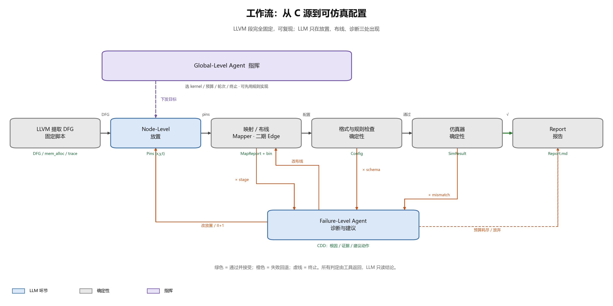

# 工作流（v0.6）

> 一句话：LLVM 把 C 提取成 DFG；LLM 决定关键节点落在哪个 PE、哪个周期；寻路程序把边接通；仿真器裁决对错；失败由诊断角色分类回退。
>
> 两条实验臂共用这条主链，只在「谁做布局、谁做布线」上互换，见 [PLAN.md](PLAN.md)。



## 0. LLVM 段：固定，不经 LLM

参数是编译器选项，不是搜索变量。每个 kernel 一份 `configs/<kernel>.yaml`，脚本照着跑：

```
clang -D CGRA_COMPILER -target i386-unknown-linux-gnu -O2 \
      -fno-tree-vectorize -fno-unroll-loops -S -emit-llvm   # kernel.ll
opt -gvn -mem2reg ... -indvars                               # kernel_opt.ll
opt -load libdfggenPass.so -fn <kernel> -nobanks N -banksize B \
      -type PartPred -skeleton                               # DFG.xml + mem_alloc.txt
clang instrumentation.cpp ... ; llvm-link ; llc ; ./final    # memtraces/*.txt
```

产出三样：`DFG.xml`、`<kernel>_mem_alloc.txt`、`memtraces/<kernel>_trace_*.txt`。
后两步（映射、仿真）只认这三样，不再碰源码。

调这些参数属于「改编译选项」的实验，不在 v1 的搜索空间内。

## 1. 状态机

| 状态 | 谁 | 做什么 | 成功 → | 失败 → |
|---|---|---|---|---|
| S0 init | Global | 读 config，建 run 目录，记预算 | S1 | 配置非法 → S9 |
| S1 dfg | 工具 | `dfg_build.sh`：编译、插桩、跑 trace | S2 | 编译/DFG 错 → S9（附日志） |
| S2 facts | 工具 | `facts(dfg, arch, ii)`：节点、边、bank、ResMII | S3 | 解析错 → S9 |
| S3 place | **Node-Level** | LLM 读 facts + arch，产出关键节点 `(x,y,t)` | S4 | schema 错：重问 ≤2 次 → S9 |
| S4 validate | 工具 | R1–R5 + 每相位容量 | S5 | 规则错 → S8（逐条错误） |
| S5 map | 工具 | `cgra_xml_mapper -m 3 --pins --report` | S6 | `stage=placement` / `stage=route` / 超时 → S8 |
| S6 check | 工具 | schema 校验 + bin 完整性 + `hycube_simulator` | S7（`mismatches=0`） | mismatch → S8 |
| S7 accept | Global | 更新 best，决定是否再降 II | S3（降 II）或 S9 | 预算尽 → S9 |
| S8 diagnose | **Failure-Level** | 读 `MapReport` / `SimResult`，产出 CDD | `repin` S3 / `reroute` S5 / `ii+1` S3 / `abort` S9 | 轮次尽 → S9 |
| S9 report | Report | 打包 `RunBundle`：位流、pin、报告、成本 | 结束 | — |

失败只有四条路：

- **pin 不合法 / 被拒** → 回 S3 改放置。
- **路由失败或 II 偏高** → 回 S5 换布线策略或加 II。
- **仿真 mismatch** → 回 S8 归因，多数仍回 S3 改相位（失配几乎都是相位错）。
- **工具链本身失败**（编译、DFG、超时）→ 直接 S9，不自动重试。

## 2. 工具

| 工具 | 何时 | 签名 | 产出 |
|---|---|---|---|
| `dfg_build.sh` | S1 | `dfg_build.sh <kernel> <config.yaml>` | DFG.xml / mem_alloc / trace |
| `facts` | S2 | `facts --dfg --arch --ii` | `facts.json`（+ 给 LLM 的紧凑文本） |
| `validate` | S4 | `validate --facts --pins --ii` | `{errors, warnings}` |
| `cgra_xml_mapper` | S5 | `-d <dfg> -x -y -j <arch> -i <II> -t HyCUBE_4REG -m 3 --pins <json> --pins_mode <1\|2\|3> --report <json>` | `MapReport` + `*.bin` |
| `hycube_simulator` | S6 | `-x -y -c <bin> -d <trace> -a <mem_alloc> -m <mem>` | `SimResult` |
| `jobdir` | 全程 | 独立 cwd、超时、sha256、日志 | 证据包 |
| `store` | S7/S8 | 缓存映射结果、检索 CDD 案例 | 命中记录 |
| `report` | S9 | 汇总为 Markdown + 图 | `Report.md` |

二期加 `route_check`（端口占用、跳数、方向合法性）与 `route_encode`（抽象跳序列 → route code），那时 S5 才允许 LLM 参与布线。

## 3. 数据契约

- `Placement`：`{pins: [{node, x, y, t}], ii, note}`。只给关键节点；空 pin 集合是合法的。
- `MapReport`：`{ok, stage: done|placement|route, ii, lat, pins_total, pins_applied, pins_rejected, error, placement[], elapsed}`。
- `SimResult`：`{ok, matches, mismatches, cycles, vector}`。
- `CDD`：`{layer: node|edge|failure, root_cause, evidence_refs[], action: repin|reroute|ii+1|abort, confidence}`。

所有产物写成文件，agent 只通过文件与工具交互，不靠对话记忆。

## 4. 四层命名

| 层 | 名字 | 看什么 | 改什么 |
|---|---|---|---|
| 全局 | Global-Level | 整个 run | 预算、轮次、去留 |
| 节点 | Node-Level | 一个 DFG 节点 | 落哪个 PE、哪个周期 |
| 边 | Edge-Level（二期） | 一条数据边 | 走哪条路径 |
| 故障 | Failure-Level | 一次失败 | 根因、回哪一层 |

## 5. 与参考工作对应

- **Beacon**：分层 agent + 固定工具链的流水线，最接近本方案；差别是 Beacon 调硬件参数，本方案调编译映射。
- **MACO**：端到端 co-design，边界宽、循环深；本方案只保编译段，换取可验证性与复现性。
- **Morpher**：提供映射与仿真实体；本方案在它外面加放置先验与失败归因。
